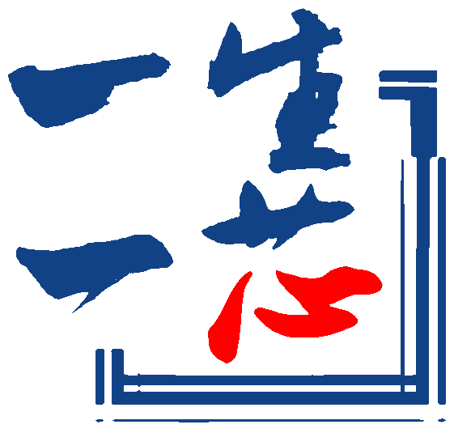

## Hi there 👋

I'm @VectorFruit, a senior undergraduate at Taiyuan University of Technology. My major is Mineral Processing Engineering at the College of Mineral Engineering, and I'm also taking a minor in Intelligent Electronic Systems at the College of Electronic Information Engineering.

I'm interested in computer architecture, digital design, RISC-V, and open-source hardware. I come from a non-CS/EE major, so I've been filling in the fundamentals through open-source materials, practice, and help from the community. I'm also continuing to learn the RTL-to-SoC design flow and some verification/debugging methods.

I also work as a teaching assistant in the One Student One Chip (一生一芯) program. Most of my work is helping with Q&A, technical review, and group discussions. I learn a lot from the participants and the teaching team.

I hope to grow into a computer systems engineer, and I'm trying to build the necessary skills step by step.

### Selected experience

- **Processor design and verification practice**: through the One Student One Chip program and a team CPU project, I have built a basic understanding of the path from instruction-set simulation to RTL processor design and SoC integration. This gave me some hands-on experience with processor microarchitecture, RTL design, bus interfaces, verification/debugging, and waveform-based analysis. In the team project, I mainly worked on selected modules and debugging, and got some exposure to dual-issue pipelines, FPGA bring-up, Buildroot/Linux boot, and Difftest-based verification. I also learned a lot from team collaboration and from reviewing other participants' work as a TA.

- **Small open-source tooling**: made a Tauri/Rust desktop tool and published it to Arch Linux AUR; still learning and iterating based on feedback.

### Frequently used

    
    
    
    

### Currently learning

    
    

Verilog/HDL, computer architecture basics, and verification/debugging with tools such as Verilator and QEMU.

### Interested in

Computer architecture · RISC-V · Open-source hardware

> "The sky is the limit."  
> "天空即为极限。"
